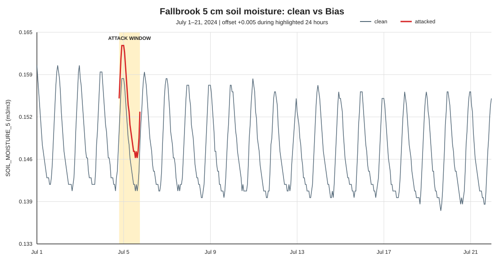
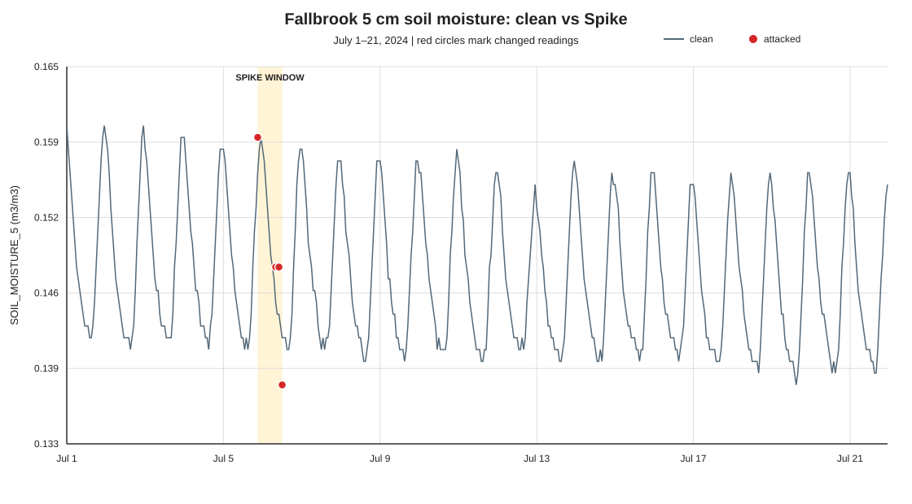

# TSYP14 Track 2 — False-Data Injection Project Documentation

This document describes the repository as it exists at inspection time. It separates implemented code and verified outputs from the wider system described by the project contract. It does not document or disclose held-out attack configurations.

## 1. Project overview

TSYP14 Track 2 studies **false-data injection (FDI)** in a sensor data pipeline. FDI is an attack that changes a measurement or packet so a system receives a value that did not come from the genuine sensor reading. The project uses hourly soil observations from the NOAA U.S. Climate Reference Network (USCRN) to demonstrate two security problems:

1. A compromised sensor can report a false value and sign it with its legitimate key.
2. An attacker can change or resend a packet after the sensor has signed it.

Sensor data integrity matters because downstream decisions may rely on the measurements. Cryptography can show who signed a packet and whether signed bytes changed; it cannot prove that a trusted sensor reported a physically true measurement.

The intended objectives in the [data contract](../data_contract.md) are to prepare reproducible clean and attacked observations, check packet authenticity and replay conditions with a cryptographic gate, apply an AI anomaly detector to packets that pass the gate, and evaluate both stages using separate ground-truth labels.

**Verified milestone:** the repository contains a clean Parquet dataset, two Bias modes, Replay and six Tamper modes, two 2024 Bias demonstration CSVs, signed packet fixtures, unit tests, a configuration runner, and a contract validator. The sensor emulator, Salma's Stage-1 gate, AI detector, and end-to-end evaluation are not present in this repository snapshot. The provisional v2 runner configuration has no scheduled runs, so it has produced no batch.

## 2. System architecture

### Intended pipeline

~~~mermaid
flowchart LR
    A[NOAA USCRN hourly observations] --> B[Clean observations in Parquet]
    B --> C{Attack location}
    C -->|Pre-sign: Bias, Drift, Mimicry| D[Sensor emulator]
    D --> E[Ed25519 signed packet]
    E --> G[Stage 1 cryptographic gate]
    C -->|Post-sign: Replay, Tamper| F[Packet stream attack]
    F --> G
    G -->|valid packets only| H[Stage 2 AI anomaly detector]
    G -->|rejected packets| I[Gate result]
    H --> J[Detector output]
    K[Ground-truth labels and event records] --> L[Evaluation harness]
    I --> L
    J --> L
~~~

### Implemented versus intended

| Component | Status in this repository |
| :--- | :--- |
| Clean USCRN Parquet input | Present at data/processed/uscrn_clean.parquet; passes the validator. |
| Pre-sign-style Bias transformation | Implemented for constant-offset and Spike modes. It transforms a DataFrame; no signing emulator is present. |
| Ground-truth labels and event metadata | Returned separately by the engine and included in the two standard demonstration artifacts. |
| Sensor emulator and Ed25519 signing | No emulator is present. The repository has a five-packet signed fixture and a public-key registry. |
| Post-sign Replay and Tamper | Implemented in `attack_engine.py`, with packet fixtures and validator-backed tests. |
| Stage 1 cryptographic gate | Intended checks are documented; no gate implementation is present. |
| Stage 2 AI detector | Intended by the contract; no model, detector output, or result is present. |
| Configuration runner | `make_attacks.py` can write one CSV per station and interval-start year plus one combined event ledger. Its current configuration has no runs; no provisional v2 batch has been generated. |
| Evaluation harness | An end-to-end scoring harness is not present. |

The Bias CSVs are labeled evaluation artifacts. No sensor emulator or detector consumed them during the verified demonstrations.

## 3. Attack-engine work scope

The inspected work scope, without identifying an individual author:

| Attack | Status | Evidence |
| :--- | :--- | :--- |
| Constant-offset Bias | **Implemented and demonstrated** | A 2024 Fallbrook CSV and plot; unit tests cover reproducibility and constraints. |
| Spike Bias | **Implemented and demonstrated** | A 2024 Fallbrook CSV and plot; unit tests cover spike count, spacing, bounds, labels, and metadata. The attack code remains bias; mode is spike. |
| Replay | **Implemented** | The engine replays contiguous hourly signed packets and emits contract-format event metadata. |
| Tamper | **Implemented** | The engine supports payload, signed-header, signature, station, and field tampering modes. |

Drift, Mimicry, and held-out variants are also not implemented in the current engine.

## 4. Dataset documentation

### Source and repository copy

The contract identifies the source as NOAA USCRN Hourly02 data. It says the clean dataset was built from raw station/year files by clean_uscrn.py and references a quality report. Those raw files, the cleaning script, and that report are absent from the inspected repository. The clean file present is [data/processed/uscrn_clean.parquet](../data/processed/uscrn_clean.parquet).

Read-only inspection found **210,384 rows and 23 columns**, six stations with 35,064 observations each. Stored time values range from 2022-01-01 01:00:00 to 2026-01-01 00:00:00. The final timestamp is an hour-ending record for an interval begun on 2025-12-31; annee stores the interval-start year. The row grid is hourly, with sensor outages represented as nulls rather than deleted rows.

Stations: AZ_Tucson_11_W, CA_Fallbrook_5_NE, MS_Newton_5_ENE, NY_Ithaca_13_E, OK_Goodwell_2_E, and OK_Goodwell_2_SE.

### Observation columns

The schema requires these 23 fields in this exact order:

~~~text
time, station, annee, LATITUDE, LONGITUDE, T_HR_AVG, T_MAX, T_MIN,
P_CALC, SOLARAD, SUR_TEMP, RH_HR_AVG, SOIL_MOISTURE_5,
SOIL_MOISTURE_10, SOIL_MOISTURE_20, SOIL_MOISTURE_50,
SOIL_MOISTURE_100, SOIL_TEMP_5, SOIL_TEMP_10, SOIL_TEMP_20,
SOIL_TEMP_50, SOIL_TEMP_100, flag_incoherence_verticale
~~~

time is UTC and marks the end of the hour. station and time form the primary key. annee is the year in which the hourly interval began. Latitude and longitude are checked against the station registry. Other fields describe air temperatures, precipitation, solar radiation, surface temperature, humidity, soil moisture at several depths, soil temperatures at several depths, and the contract's vertical-incoherence flag.

SOIL_MOISTURE_5 is volumetric water content at 5 cm, in cubic metres of water per cubic metre of soil (m³/m³). It is the protected measurement. The JSON schema specifies a resolution of **0.001** and allows nulls. The actual clean file has 5,401 missing values in this column; it has no missing time, station, location, or annee values. Deeper soil readings have additional missing values, including depths absent at some stations.

The contract says missing readings remain null/NaN, rows are not removed, and values are not interpolated. The engine preserves missing target readings and never labels them as attacked.

### Dataset integrity

The clean Parquet SHA-256, computed from the current file bytes, is:

~~~text
46b98115424bb03af28d31bcb96b68fedd537a609bf97d4199a653a376b98421
~~~

The same digest was observed before and after generating the standard Bias demonstrations. This establishes that the current file matches the recorded digest and that those demonstration steps did not alter it. No separate committed checksum manifest establishes upstream provenance.

### Contract discrepancies and split status

The soil-moisture upper-bound disagreement remains unresolved:

| Source | Upper bound |
| :--- | ---: |
| data_contract.md, §7.2 | 0.70 |
| data_contract.schema.json | 0.65 |
| attack_engine.py temporary guard | 0.65 |

The engine uses the JSON schema's 0.65 ceiling. This is a conservative implementation guard, **not** an amendment or resolution of the Markdown contract. Samples pass the current validator, which reads the JSON schema.

There is also a split-status mismatch: the Markdown contract says the evaluation split is confirmed, while the JSON schema records status as proposed. The documented periods are train 2022–2023, validation 2024, and test 2025. This document records both statements without deciding which is authoritative.

## 5. Project structure

The following shows the main project files relevant to this work.

~~~text
TSYP14/
├── attack_engine.py
├── make_attacks.py
├── requirements.txt
├── README.md
├── data_contract.md
├── data_contract.schema.json
├── validate.py
├── test_attack_engine.py
├── test_make_attacks.py
├── config/
│   └── provisional_v2.json
├── keys/
│   └── pubkeys.json
├── data/
│   ├── processed/
│   │   └── uscrn_clean.parquet
│   ├── packets/
│   │   └── replay_test_valid.jsonl
│   └── attacked/
│       ├── attack_events.csv
│       ├── bias_run01.csv
│       ├── bias_run01_clean_vs_attacked.svg
│       ├── spike_run01.csv
│       ├── spike_run01_clean_vs_attacked.svg
│       └── packets/ (local Replay and Tamper examples)
└── docs/
    ├── BEGINNER_GUIDE.md
    └── COMPLETE_PROJECT_DOCUMENTATION.md
~~~

| File or folder | Purpose |
| :--- | :--- |
| attack_engine.py | Shared DataFrame interface for Bias/Spike and packet interface for Replay/Tamper. |
| make_attacks.py | Configuration runner; groups non-overlapping configured events by station and interval-start year. |
| config/provisional_v2.json | 2024/2025 profile settings; its run list is empty. |
| requirements.txt | Pinned direct Python dependencies. |
| test_attack_engine.py and test_make_attacks.py | Unit and validator integration tests for engine and runner behavior. |
| validate.py | Validates observation, attacked, event, or packet files against the JSON schema. |
| data_contract.md | Human-readable data flow, security design, schema rules, and evaluation plan. |
| data_contract.schema.json | Machine-readable columns, field rules, station registry, labels, packet format, and split periods. |
| data/processed/uscrn_clean.parquet | Clean input observations. |
| data/attacked/*_run01.csv | Labeled local demonstration observations. |
| data/attacked/attack_events.csv | One event row per standard Bias demonstration. |
| data/attacked/*_clean_vs_attacked.svg | Standalone vector plots; no plot-generation script is present. |
| data/packets/replay_test_valid.jsonl and keys/pubkeys.json | Five signed example packets and the public registry used to verify them. |
| data/attacked/packets/ | Local Replay and Tamper packet examples with separate label sidecars. |
| docs/ | Technical documentation and beginner guide. |

The detector-output location described by the contract is not populated here.

## 6. Attack-engine implementation

### Shared interface

~~~python
attacked_data, labels, event = attack_data(clean_data, params)
~~~

The function requires a Pandas DataFrame with at least time, station, and SOIL_MOISTURE_5, plus a parameter dictionary. It returns:

1. **attacked_data:** a deep copy of observations, with only selected SOIL_MOISTURE_5 cells changed.
2. **labels:** a separate DataFrame with is_attacked, attack_type, and attack_run_id, aligned to the input index.
3. **event:** one dictionary using the nine contracted event fields.

The function does not write files. The demonstration CSVs are assembled separately from the observation and label DataFrames.

### Parameters

| Parameter | Meaning |
| :--- | :--- |
| attack_type | Must be bias. Spike is Bias with mode="spike". |
| mode | constant_offset or spike. |
| station | Station eligible for attack. |
| seed | Integer used by a local random.Random instance. |
| years | Non-empty, unique selection from 2024 and 2025. |
| duration_hours_range | Inclusive integer [minimum, maximum] range. |
| offset_range | Required for constant_offset; explicit signed range supplied by caller. |
| spike_count_range | Required for spike; inclusive positive integer range. |
| spike_magnitude_range | Required for spike; explicit signed decimal range. |

Magnitude ranges are caller supplied; no statistical rule is inferred by the engine.

### Window selection, time, and values

The engine parses time as UTC, selects the requested station and years, sorts entries chronologically, and finds hourly contiguous runs. Invalid or duplicate timestamps for the chosen station are rejected.

For constant-offset Bias, missing readings and infeasible/no-op/out-of-bounds rows split candidate runs. One non-zero offset is sampled on the 0.001 grid. Feasible windows are counted and one start is selected by index, avoiding a large collection of copied windows. No feasible window results in a descriptive ValueError rather than indefinite retries.

For Spike, missing rows may be inside the selected duration window but cannot be chosen as spike timestamps. Selected spike times are at least two hours apart, leaving one hourly row unchanged between them. A requested count that cannot fit the duration/spacing constraint raises a clear error. Candidate spike magnitudes are filtered per reading so the rounded result is in bounds and changes that reading.

Both modes round to 0.001 using decimal arithmetic and ROUND_HALF_UP. Both enforce the temporary inclusive range [0, 0.65] and omit unchanged readings from labels. The input is not edited; other columns and unselected observations are preserved.

### Labels, events, and run IDs

Labels are true only where the target value actually changed. Clean rows have false and empty attack_type and attack_run_id. The generated attack_run_id includes the mode, station, first attacked time, and a SHA-256 over sorted JSON containing the configuration and selected parameters. This makes repeated calls with the same input/configuration deterministic and distinguishes different configurations.

The event field order is attack_run_id, station, attack_type, target_columns, start, end, params_json, seed, engine_version. start/end are the first/last actual attacked timestamps. For Spike, the full selected duration window is separately recorded in params_json along with every spike time and signed magnitude.

## 7. Constant-offset Bias

### Idea, formula, and steps

The simulated compromised sensor adds one constant signed offset to every eligible reading in a contiguous window:

~~~text
attacked_value = round_to_0.001(clean_value + offset)
~~~

The caller supplies offset_range. The seeded engine samples a non-zero value on the 0.001 grid and checks that the result changes after rounding and lies in [0, 0.65].

1. Validate the DataFrame, station, seed, requested years, duration, and explicit offset range.
2. Sample the offset using the seed.
3. Build station/year contiguous runs, splitting at missing readings, time gaps, no-op results, and bounds violations.
4. Select a feasible window in the requested duration range.
5. Copy the input and change only selected SOIL_MOISTURE_5 cells.
6. Return changed-row labels and one event.

If no feasible window exists, the function raises ValueError.

### Verified July 2024 example

The actual [bias_run01.csv](../data/attacked/bias_run01.csv) contains 504 rows for CA_Fallbrook_5_NE from July 1 through July 21, 2024. It uses seed 20240701, duration 24 hours, and the explicit range [0.005, 0.005]. The resulting **+0.005** offset applies from **2024-07-04 19:00 through 2024-07-05 18:00**, inclusive. All 24 readings changed and all 24 are labeled. For example, 0.150 at 19:00 became 0.155.

The range is a demonstration input, not a final statistical magnitude policy.

### Limitations

Only SOIL_MOISTURE_5 changes. There is no agreed final station-statistics-based magnitude rule, the 0.65 bound is temporary, and no AI detector has been tested against this sample.

## 8. Spike injection

### Behavior

Unlike constant-offset mode, Spike changes a configured number of individual readings inside a selected duration window. It samples a separate signed magnitude for each spike from the explicit range and chooses distinct timestamps with at least one unchanged hourly reading between spikes. Other rows in the window remain unchanged.

### Verified July 2024 example

The actual [spike_run01.csv](../data/attacked/spike_run01.csv) contains the same 504-row Fallbrook period. It uses seed 20240715, a 24-hour selected window from 2024-07-05 13:00 to 2024-07-06 12:00, four spikes, and supplied magnitude range [-0.005, 0.005]:

| Timestamp UTC | Clean | Attacked | Signed change |
| :--- | ---: | ---: | ---: |
| 2024-07-05 21:00 | 0.156 | 0.159 | +0.003 |
| 2024-07-06 08:00 | 0.145 | 0.148 | +0.003 |
| 2024-07-06 10:00 | 0.144 | 0.148 | +0.004 |
| 2024-07-06 12:00 | 0.142 | 0.138 | −0.004 |

All four readings have labels. Event start/end are the first/last spike times; params_json contains the full selected window and each timestamp/magnitude. Both event and row attack_type are bias; mode is spike.

The current Spike implementation preserves missing readings, but the selected duration envelope can include missing rows. The contract says evaluation windows skip gaps; this behavior should be reconciled before applying the engine to evaluation windows.

## 9. Contract and output formats

### Attacked observation files

Each CSV contains the 23 contracted observations, in exact schema order, then these three labels:

| Field | Meaning |
| :--- | :--- |
| is_attacked | True only for a changed observation. |
| attack_type | bias on changed rows; empty for clean rows. |
| attack_run_id | Links changed rows to their event; empty for clean rows. |

Both current standard CSVs have 504 rows and 26 columns. Labels are evaluation ground truth. Contract §9.1 requires they be stripped before signing or AI-detector input; the engine returns them separately to support this separation.

### Events file

[attack_events.csv](../data/attacked/attack_events.csv) has one row per attack and currently contains the constant Bias and Spike events.

| Field | Meaning |
| :--- | :--- |
| attack_run_id | Unique event/run identifier. |
| station | Attacked station. |
| attack_type | Contract attack code; bias for these demonstrations. |
| target_columns | Semicolon-separated changed field(s); here SOIL_MOISTURE_5. |
| start, end | First and last actual attacked timestamps, inclusive. |
| params_json | Configuration and selected parameters. |
| seed | Random seed. |
| engine_version | Current engine version, 0.1.0. |

The validator checks event columns, known station/attack code, parseable start/end, JSON parseability, numeric seed, and target column names. It does not prove signatures, detector behavior, or every label-to-event relationship.

### Public standard demonstration configurations

~~~python
constant_bias = {
    "attack_type": "bias", "mode": "constant_offset",
    "station": "CA_Fallbrook_5_NE", "seed": 20240701,
    "years": [2024], "duration_hours_range": [24, 24],
    "offset_range": [0.005, 0.005],
}

spike_bias = {
    "attack_type": "bias", "mode": "spike",
    "station": "CA_Fallbrook_5_NE", "seed": 20240715,
    "years": [2024], "duration_hours_range": [24, 24],
    "spike_count_range": [4, 4],
    "spike_magnitude_range": [-0.005, 0.005],
}
~~~

Abbreviated example from the current Spike event:

~~~json
{
  "attack_type": "bias",
  "mode": "spike",
  "selected_window_start": "2024-07-05 13:00:00",
  "selected_window_end": "2024-07-06 12:00:00",
  "selected_duration_hours": 24,
  "selected_spike_count": 4,
  "spikes": [
    {"timestamp": "2024-07-05 21:00:00", "magnitude": 0.003},
    {"timestamp": "2024-07-06 08:00:00", "magnitude": 0.003},
    {"timestamp": "2024-07-06 10:00:00", "magnitude": 0.004},
    {"timestamp": "2024-07-06 12:00:00", "magnitude": -0.004}
  ]
}
~~~

## 10. Testing and validation

### Unit-test cases

`test_attack_engine.py` covers Bias, Spike, Replay, and Tamper. `test_make_attacks.py` covers the station-year runner. The current suite has 44 tests. Selected cases are:

| Test | Coverage |
| :--- | :--- |
| test_constant_offset | Reproducibility, unchanged input/order, labels, exact offset, bounds/resolution, unaffected rows/stations, event fields. |
| test_no_valid_contiguous_window_raises | Missing station and no long enough valid run. |
| test_skips_bounds_invalid_window_when_feasible_window_exists | Feasible window selection when another would exceed the upper bound. |
| test_distinct_configurations_have_distinct_run_ids | Run ID responds to configuration. |
| test_out_of_bounds_configuration_raises | Upper-bound infeasibility. |
| test_lower_bound_violation_raises | Lower-bound infeasibility. |
| test_2025_is_configurable_but_first_fixture_is_2024 | Interface accepts a 2025 request; 2024-only fixture has no matching run. No 2025 sample is generated. |
| test_spike_count_spacing_bounds_labels_and_event | Spike count/spacing, missing values, labels, rounding/bounds, untouched columns, metadata. |
| test_spike_seed_is_reproducible | Same seed gives same Spike outputs and event. |
| test_spike_count_must_fit_spacing_and_duration | Infeasible count/duration raises a clear error. |
| test_replay_event_passes_events_validator | Exact event timestamp strings and `validate.py events` exit code 0. |
| test_multiple_events_share_one_station_year_file_without_overlap | Two runs share one labeled CSV and one combined event ledger. |
| test_spike_reserves_full_window_including_unchanged_hours | A later run cannot enter a selected Spike window between spikes. |
| test_representative_station_year_and_event_outputs_validate | Temporary 2024 station-year and combined event files pass the validator. |

### Test command and actual result

From the repository root in PowerShell:

~~~powershell
& 'C:/Users/USER/tsyp14-venv/Scripts/python.exe' -B -m unittest discover -v
~~~

At the latest runner update, **44 tests ran in 10.369 seconds and all passed (OK)**.

### Validator usage and actual results

The validator loads data_contract.schema.json. These PowerShell commands use the configured interpreter and invoke the existing script through runpy:

~~~powershell
& 'C:/Users/USER/tsyp14-venv/Scripts/python.exe' -B -c "import runpy,sys; sys.argv=['validate.py','observations','data/processed/uscrn_clean.parquet']; runpy.run_path('validate.py',run_name='__main__')"
& 'C:/Users/USER/tsyp14-venv/Scripts/python.exe' -B -c "import runpy,sys; sys.argv=['validate.py','attacked','data/attacked/bias_run01.csv']; runpy.run_path('validate.py',run_name='__main__')"
& 'C:/Users/USER/tsyp14-venv/Scripts/python.exe' -B -c "import runpy,sys; sys.argv=['validate.py','attacked','data/attacked/spike_run01.csv']; runpy.run_path('validate.py',run_name='__main__')"
& 'C:/Users/USER/tsyp14-venv/Scripts/python.exe' -B -c "import runpy,sys; sys.argv=['validate.py','events','data/attacked/attack_events.csv']; runpy.run_path('validate.py',run_name='__main__')"
~~~

All four reported VALID against contract v1.0.0 during this review.

**Unit tests** check selected engine behavior on synthetic fixtures. **Contract validation** checks schema structure and selected data rules. Neither proves statistical realism, signature correctness, detector accuracy, or end-to-end security. No security/integration tests have been run.

## 11. Results and interpretation

| Sample | Rows | Changed readings | Verified transformation |
| :--- | ---: | ---: | :--- |
| Constant-offset Bias | 504 | 24 | +0.005 hourly from 2024-07-04 19:00 through 2024-07-05 18:00. |
| Spike Bias | 504 | 4 | +0.003, +0.003, +0.004, and −0.004 at the timestamps listed in §8. |

Both use 2024 Fallbrook data and passed validation when generated. The Parquet digest remained 46b98115424bb03af28d31bcb96b68fedd537a609bf97d4199a653a376b98421. The current unit suite also covers Replay, Tamper, and the station-year runner; its latest result should be taken from a fresh test run.

These results show that the current engine produced the stated changes reproducibly, returned separate labels, preserved the input, and created CSVs accepted by the current validator. They do **not** show an AI detection rate, gate result, signature, performance measurement, or generalization to 2025.

Plots: [constant Bias SVG](../data/attacked/bias_run01_clean_vs_attacked.svg) and [Spike SVG](../data/attacked/spike_run01_clean_vs_attacked.svg). The first highlights the selected interval and altered line; the second marks changed timestamps.

## 12. Ed25519, Replay, and Tamper

Ed25519 is a public-key signature scheme: a private key creates a signature and the corresponding public key verifies it. A valid signature shows that the signed message matches bytes signed by the private key. It does not show that the sensor measurement was truthful.

**Pre-sign attack:** a compromised sensor changes a measurement and then signs the false value. The signature can be valid, so Stage 1 cannot identify the lie by signature validity alone. Stage 2 is intended to assess plausibility.

**Post-sign attack:** an attacker modifies signed data or resends an old packet. The contract intends Stage 1 to detect these conditions.

| Attack | Intended behavior | Relevant contract codes | Status |
| :--- | :--- | :--- | :--- |
| Replay | Resend an authentic old packet or present it as current. | E_REPLAY_SEQ, E_REPLAY_NONCE, E_STALE | **Implemented in the attack engine; gate integration remains outside this repository.** |
| Tamper | Change payload/header after signing without a valid new signature. | E_PAYLOAD_HASH, E_BAD_SIG | **Implemented in the attack engine; gate integration remains outside this repository.** |

Other contract gate codes include E_SCHEMA, E_UNKNOWN_KEY, W_SEQ_GAP, and OK. The ordered checks are in contract §8. No Stage 1 or Stage 2 integration test has passed; those components are absent.

## 13. Known issues and limitations

1. **0.65/0.70 discrepancy:** Markdown and schema disagree; the implementation follows 0.65 temporarily.
2. **Split status:** Markdown says confirmed, schema says proposed.
3. **Magnitude selection:** callers pass explicit ranges; there is no agreed final statistical rule.
4. **Interface compatibility:** attack_data(clean_data, params) is the working interface, but compatibility with an external AI pipeline has not been tested.
5. **Missing-data windows:** Spike does not modify nulls, but its selected duration envelope can include them. Contract §7.4 says evaluation windows skip gaps.
6. **No end-to-end integration:** Replay and Tamper generation and validator checks exist, but the signing emulator, Salma's Stage-1 gate, detector, and evaluation scoring harness are not present here.
7. **Data provenance:** contract-described raw inputs, cleaner, and quality report are absent, limiting independent reproduction of the clean dataset.
8. **Validator scope:** a valid result is not proof that labels align with every changed cell or that an attack is detected.
9. **Held-out status:** no held-out artifact or commitment is present. Repository files cannot establish whether external AI tuning has started; no pre-tuning commitment is claimed.
10. **Plot generation:** SVG artifacts exist, but their source generator is not in the repository.

## 14. Next milestones

1. Reconcile the hard-bound and split-status documents with the contract owner.
2. Agree and document the station-derived magnitude policy.
3. Confirm tuning status and privacy controls before preparing held-out material; keep it within the 2025 test period and secret as required.
4. Integrate the existing Replay and Tamper examples with Salma's Stage-1 gate and test ordered rejection codes, sequence, nonce, and freshness behavior.
5. Integrate attacks with the sensor emulator and Stage 1; ensure labels are stripped before signing and detector input.
6. Integrate Stage 2 and the evaluation harness, then report test results separately from validation results.
7. Prepare final reporting and presentation using verified metrics and explicit limitations.

## 15. Reproducibility guide

### Environment observed

Verification used Python **3.13.2**, Pandas **3.0.6**, PyArrow **26.0.0**, and cryptography **50.0.2**. Pandas is used by the engine, runner, tests, and validator. PyArrow reads Parquet. Cryptography verifies packet signatures with the public-key registry. SVG files are standalone and require no plotting package. `validate.py packets --pubkeys` has verified the restored signed fixture; this is separate from Salma's Stage-1 gate.

Run the test command and four validator commands in §10 from the repository root. For validator, the first argument selects observations, attacked, or events; the second is the file. Exit codes are 0 for valid, 1 for contract violations, and 2 for usage errors.

Open attack_events.csv in a spreadsheet or text editor to inspect event parameters. Open an SVG in a browser or vector-image viewer. For a configured batch, add explicit station, year, seed, and profile entries under `runs` in `config/provisional_v2.json`, then run `python make_attacks.py --config config/provisional_v2.json`. The runner writes to `data/attacked/provisional_v2/` only when runs are configured; the engine itself does not write files. Keep labels out of emulator and detector inputs and join them only for evaluation. The five signed example packets have generation-time `ts` values one second apart and cannot demonstrate an hourly observation stream; a valid hourly replacement needs new signatures from the packet owner.

Recompute the clean-file digest in PowerShell:

~~~powershell
Get-FileHash -Algorithm SHA256 -LiteralPath 'data\processed\uscrn_clean.parquet'
~~~

A matching digest confirms byte identity to the recorded value; it does not independently establish upstream NOAA provenance.
